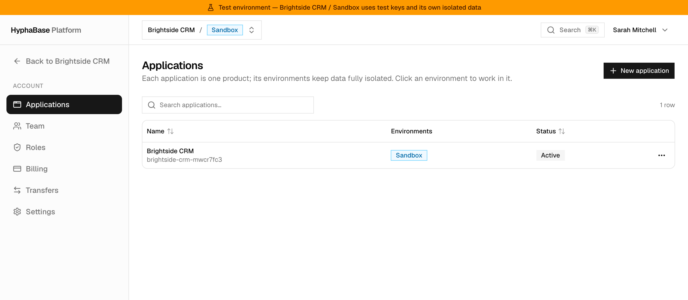
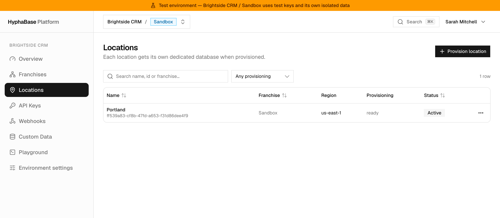
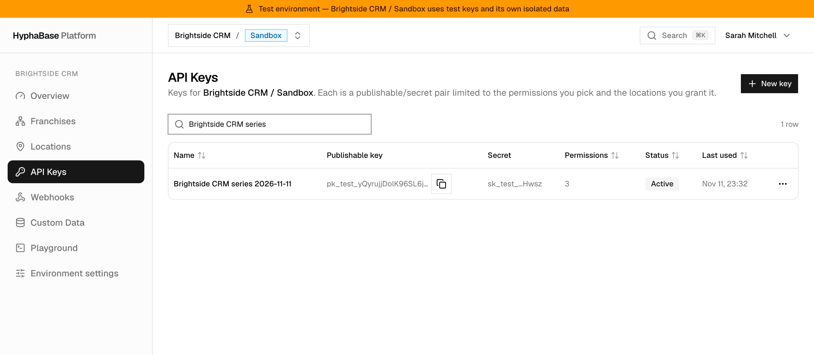

# Episode 1: the backend

**Result:** an app with one location. HyphaBase provisions a dedicated database for the location and gives you API keys.

This episode happens in the HyphaBase console, so it has no code and no tag in this repository.

## Steps

1. Create your account and your app. The series calls the app **Brightside CRM**.

   

2. Add a location. The series calls it **Portland**.
3. Wait for provisioning to finish. The location gets its own database.

   

4. Create a secret API key for the app's sandbox environment. Episode 2 needs these scopes:
   - `data.collections.manage`
   - `data.records.create`
   - `data.records.read`
5. Copy the key when it is shown. It is shown once. Afterwards the console only shows its last few characters.

   

Next: [episode 2, customers](episode-02-customers.md).
