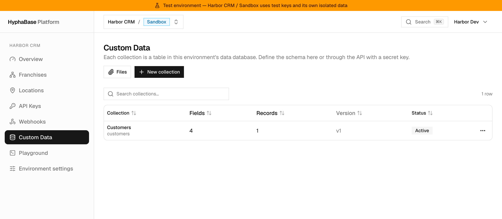
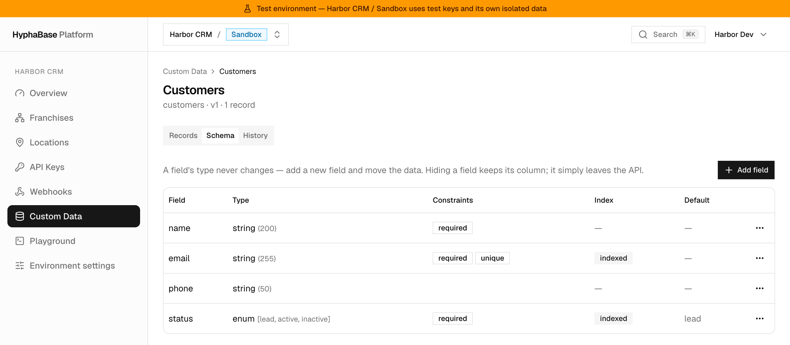
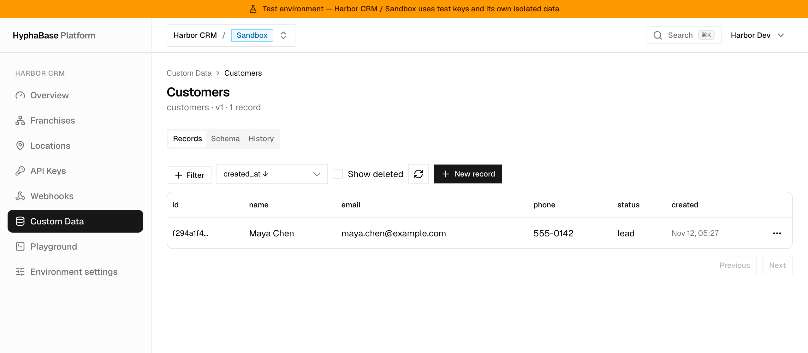

# Episode 2: customers

**Result:** the CRM has a Customers collection, and its first customer was created and read back through the API.

**Tag:** `episode-02-customers` (created when the episode is published)

**Starts from:** the app, location and secret key from [episode 1](episode-01-backend.md).

## What changed

| File | What it does |
| --- | --- |
| [`src/hyphabase.js`](../src/hyphabase.js) | About 60 lines of `fetch`: sends the secret key, parses JSON, turns failures into readable messages. |
| [`src/customers.js`](../src/customers.js) | The collection definition and four calls: ensure the collection, add, get, list. |
| [`src/setup.js`](../src/setup.js) | `npm run setup` |
| [`src/add-customer.js`](../src/add-customer.js) | `npm run customer:add` |
| [`src/list-customers.js`](../src/list-customers.js) | `npm run customer:list` |

## The collection

HyphaBase calls a data model a **collection**. You describe its fields and HyphaBase creates a real table for it:

```js
{
  slug: "customers",
  name: "Customers",
  fields: [
    { name: "name", type: "string", required: true, max_length: 200 },
    { name: "email", type: "string", required: true, unique: true },
    { name: "phone", type: "string", max_length: 50 },
    { name: "status", type: "enum", required: true, values: ["lead", "active", "inactive"], default: "lead", indexed: true },
  ],
}
```

There are no migrations to write and no CRUD endpoints to build. The three requests this episode makes:

| Step | Request |
| --- | --- |
| Define the collection | `POST /api/modules/data/collections` |
| Create a customer | `POST /api/modules/data/customers/records` |
| Read it back | `GET /api/modules/data/customers/records/{id}` |

Each one carries `Authorization: Bearer <your secret key>`.

## What it looks like in the console

After `npm run setup`, the collection appears under **Custom Data**:



Its **Schema** tab shows the fields exactly as the code defined them:



After `npm run customer:add`, the first customer is in the **Records** tab:



## Things worth noticing

- **The default applies.** The script sends no `status`; the record comes back with `status: "lead"`.
- **The API checks your data.** Run `npm run customer:add` twice and the second run is refused, because `email` is unique. Try `--status vip` and it is refused, because `vip` is not one of the allowed values.
- **A field's type is permanent.** You can add, rename and hide fields later, but a `string` stays a `string`.
- **Where the data lives.** Collections belong to the app's environment and sit in their own database, separate from other apps and environments.

## Known limits at this point

- No login: anyone holding the secret key can do everything the key allows. Episode 3 adds authentication.
- No update or delete: the key in this episode cannot delete, on purpose.
- No screens: the frontend arrives with the SDK in episode 5.
