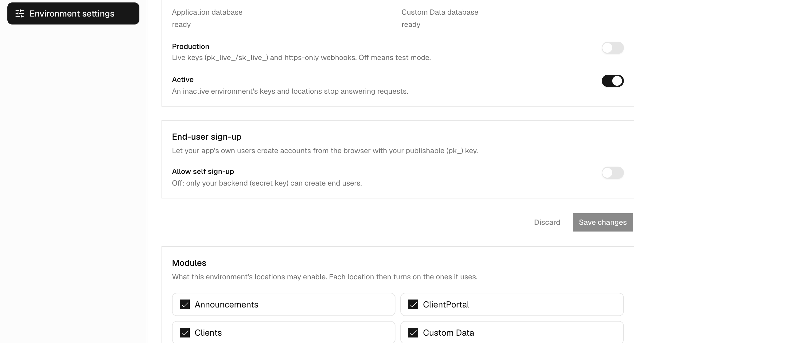

# Episode 3: authentication

**Result:** people have to sign in before they can see a customer. The CRM has its first user, Sarah, and a small server that refuses every request that does not come from a signed-in user.

**Tag:** `episode-03-authentication`

**Starts from:** the Customers collection from [episode 2](episode-02-customers.md).

## The problem

After episode 2 the only thing protecting the customers was the secret key. That is fine for a script on your own machine, but a secret key can never go to a browser or a phone, and it says nothing about *who* is asking.

So the CRM gets two things:

1. **Users**, stored by HyphaBase. It keeps the passwords (hashed), checks them at sign-in and issues the tokens. This repository has no users table, no password hashing and no session store.
2. **A server of our own**, the only place the secret key lives. It asks HyphaBase who each request comes from before it reads any customer.

```text
you (a token)  ->  the CRM server (the secret key)  ->  HyphaBase
```

## Before you start

The secret key needs one more scope and access to your location, and `.env` needs the location's id:

1. On the **API Keys** page, edit the key and add the `users.create` scope.
2. In the key's menu choose **Access** and grant it your location.
3. Copy the location's id from the **Locations** page into `.env` as `HYPHABASE_LOCATION_ID`.

Users belong to a location, which is why the key has to reach one.

## What changed

| File | What it does |
| --- | --- |
| [`src/auth.js`](../src/auth.js) | Four calls: create a user, sign in, ask who a token belongs to, sign out. |
| [`src/server.js`](../src/server.js) | The CRM server: `POST /login`, `GET /me`, `GET /customers`, `POST /logout`. Plain `node:http`. |
| [`src/session.js`](../src/session.js) | The client side: talks to the CRM server and keeps the token in `.session`. |
| [`src/add-user.js`](../src/add-user.js) | `npm run user:add` |
| [`src/serve.js`](../src/serve.js) | `npm run serve` |
| [`src/crm-signin.js`](../src/crm-signin.js), [`crm-customers.js`](../src/crm-customers.js), [`crm-signout.js`](../src/crm-signout.js) | `npm run crm:signin`, `crm:customers`, `crm:signout` |
| [`src/hyphabase.js`](../src/hyphabase.js) | A request can now be made as a user (their token) and name a location. |

## Run it

In one terminal, create Sarah and start the server:

```text
$ npm run user:add
Password for sarah@brightsideclean.example:
Created user Sarah Mitchell <sarah@brightsideclean.example>
  id        01a1cd3c-37fd-714e-8712-2b6476a2f1ed
  location  Portland

$ npm run serve
Brightside CRM is listening on http://localhost:4310
```

In a second terminal, be a person using the CRM. These commands have no secret key; they only know the server's address.

```text
$ npm run crm:customers
401 Sign in first.

$ npm run crm:signin
Password for sarah@brightsideclean.example:
Signed in as Sarah Mitchell.
Token saved to .session (valid until 2026-11-12T01:50:51+00:00).

$ npm run crm:customers
Signed in as Sarah Mitchell. 1 customer:
┌─────────┬──────────────────┬────────────────────┬────────────┬────────┐
│ (index) │ name             │ email              │ phone      │ status │
├─────────┼──────────────────┼────────────────────┼────────────┼────────┤
│ 0       │ 'Dana Whitfield' │ 'dana@example.com' │ '555-0142' │ 'lead' │
└─────────┴──────────────────┴────────────────────┴────────────┴────────┘

$ npm run crm:signout
Signed out Sarah Mitchell.

$ npm run crm:customers
401 Sign in first.
```

## The guard

Every protected route starts the same way ([`src/server.js`](../src/server.js)):

```js
async function requireUser(req, res) {
  const token = bearerToken(req);
  if (!token) {
    send(res, 401, { error: "Sign in first." });
    return null;
  }

  const user = await currentUser(api, locationId, token);
  if (!user) send(res, 401, { error: "Your session is not valid. Sign in again." });
  return user;
}
```

`currentUser` is one request to HyphaBase, made with the user's token instead of the secret key. The three HyphaBase requests behind this episode:

| Step | Request | Sent as |
| --- | --- | --- |
| Create a user | `POST /api/modules/employees/users` | the secret key, plus `X-Location-Id` |
| Sign in | `POST /api/auth/login` | the secret key (it says which app the user belongs to) |
| Who is this? | `GET /api/auth/me` | the user's token, plus `X-Location-Id` |

Signing out is `POST /api/auth/logout`, sent as the user.

## Who can create users

Only you. `npm run user:add` uses the secret key, and the environment's **Allow self sign-up** setting is off, which is the default:



A CRM is a staff tool, so that is what we want. An app with public sign-up would turn the setting on.

## What `npm run smoke` proves

The smoke test runs the server against your real environment and checks each claim above:

- no token: refused (401)
- a made-up token: refused (401)
- a wrong password: refused (401), without saying which part was wrong
- a signed-in user: gets the customers
- a signed-out token: refused (401), straight away
- a user's token sent directly to the data API, around the server: refused by HyphaBase (403)

## Things worth noticing

- **The token is not the key.** A token identifies one person and expires. The secret key identifies the app and never leaves the server.
- **Customer data is server-side only.** Even a valid user token cannot read a collection directly. The server decides what a signed-in user gets.
- **The server keeps the refresh token.** HyphaBase returns one at sign-in; this episode does not hand it out, so a session ends when the token expires or you sign out.
- **Sign-in attempts are rate limited** by HyphaBase. The server passes that on as a 429.

## Known limits at this point

- Every signed-in user can see every customer. Who may do what is [episode 4](episode-04-permissions.md), where Marcus joins.
- The server listens on `localhost` over plain HTTP. Put it behind HTTPS before anyone else uses it.
- The client is a few terminal commands. The real frontend arrives with the SDK in episode 5.

Next: [episode 4, roles and permissions](episode-04-permissions.md).
