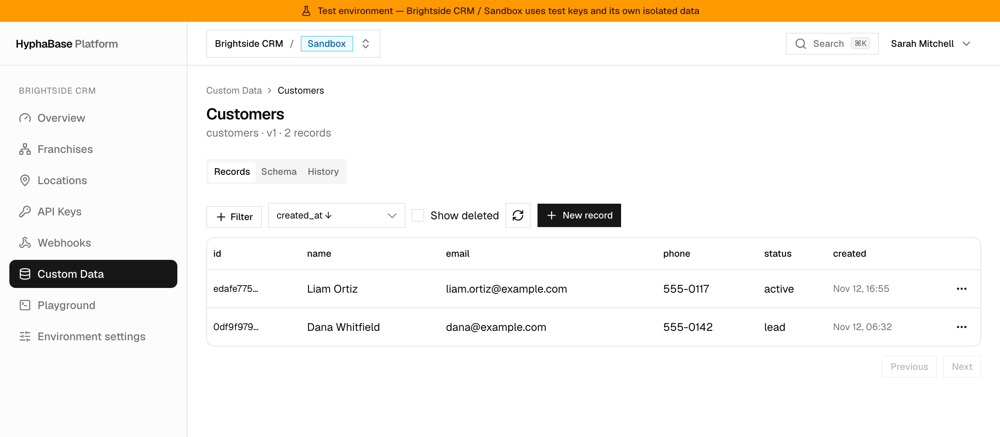

# Episode 4: roles and permissions

**Result:** being signed in is no longer enough. The CRM has two roles, Owner and Staff. Marcus, a staff member, can see the customers but cannot delete one. Sarah, the owner, can.

**Tag:** `episode-04-permissions`

**Starts from:** the sign-in and the CRM server from [episode 3](episode-03-authentication.md).

## The problem

After episode 3 the server asked one question: *who are you?* Anyone with an account could then do everything the server offered. A second person is about to join, and somebody has added a test customer by mistake:


Someone should be able to remove it. Not everyone should.

So the server asks a second question: *what may you do?* As with users, the answer is not kept in this repository:

1. **Roles**, stored by HyphaBase. A role is a name and a list of permissions. HyphaBase also stores who has which role.
2. **One question per request.** Before the server touches a customer it asks HyphaBase what the signed-in person's roles allow, and refuses if the permission it needs is not in the answer.

There is no roles table here, and no list of "admin emails" in the code.

## Before you start

The secret key needs a few more scopes. On the **API Keys** page, edit the key and add:

| Scope | Why |
| --- | --- |
| `roles.view`, `roles.create` | define the two roles |
| `users.view` | find a user by email |
| `roles.assign` | give a user a role |
| `data.records.delete` | delete a customer, for the people allowed to |

Then create the second user, Marcus, the same way as Sarah:

```text
$ npm run user:add -- --name "Marcus Bell" --email marcus@brightsideclean.example
Password for marcus@brightsideclean.example:
Created user Marcus Bell <marcus@brightsideclean.example>
  id        01a1cf2e-9bef-7335-8794-bb5c092bff2e
  location  Portland
```

## What changed

| File | What it does |
| --- | --- |
| [`src/roles.js`](../src/roles.js) | The two roles, and four calls: create a role, find a user, give a user a role, ask what a user may do. |
| [`src/server.js`](../src/server.js) | `GET /customers` now needs a permission. New: `DELETE /customers/:id`. `GET /me` also says what you may do. |
| [`src/customers.js`](../src/customers.js) | `deleteCustomer`. |
| [`src/setup-roles.js`](../src/setup-roles.js) | `npm run roles:setup` |
| [`src/give-role.js`](../src/give-role.js) | `npm run role:give` |
| [`src/crm-me.js`](../src/crm-me.js), [`crm-delete.js`](../src/crm-delete.js) | `npm run crm:me`, `crm:delete` |

## The roles

Both are plain data ([`src/roles.js`](../src/roles.js)):

```js
export const CAN = {
  readCustomers: "data.records.read",
  addCustomers: "data.records.create",
  deleteCustomers: "data.records.delete",
};

export const ROLES = {
  owner: { name: "Owner", permissions: [CAN.readCustomers, CAN.addCustomers, CAN.deleteCustomers] },
  staff: { name: "Staff", permissions: [CAN.readCustomers] },
};
```

The permission names are HyphaBase's own. A role cannot carry a permission that does not exist; the API refuses it with `The permission ... does not exist.`

## Run it

Start the server (`npm run serve`) and, in a second terminal, sign in as Marcus. He has an account and no role:

```text
$ npm run crm:signin -- --email marcus@brightsideclean.example
Password for marcus@brightsideclean.example:
Signed in as Marcus Bell.

$ npm run crm:me
Signed in as Marcus Bell <marcus@brightsideclean.example>.
No role yet, so nothing is allowed.

$ npm run crm:customers
403 Your role does not allow this.
```

Signed in is not the same as allowed. In episode 3 that last command returned every customer.

Create the roles and hand them out. These two commands use the secret key, so only you can run them:

```text
$ npm run roles:setup
Created role Owner
  data.records.read
  data.records.create
  data.records.delete
Created role Staff
  data.records.read

$ npm run role:give -- --email sarah@brightsideclean.example --role owner
Sarah Mitchell now has the Owner role:
  data.records.read
  data.records.create
  data.records.delete

$ npm run role:give -- --email marcus@brightsideclean.example --role staff
Marcus Bell now has the Staff role:
  data.records.read
```

Marcus does not need to sign in again. The role applies to the token he already has:

```text
$ npm run crm:me
Signed in as Marcus Bell <marcus@brightsideclean.example>.
Allowed:
  data.records.read

$ npm run crm:customers
Signed in as Marcus Bell. 3 customers:
┌─────────┬──────────────────┬──────────────────────────┬────────────┬──────────┐
│ (index) │ name             │ email                    │ phone      │ status   │
├─────────┼──────────────────┼──────────────────────────┼────────────┼──────────┤
│ 0       │ 'Liam Ortiz'     │ 'liam.ortiz@example.com' │ '555-0117' │ 'active' │
│ 1       │ 'Test Customer'  │ 'test@example.com'       │ '555-0100' │ 'lead'   │
│ 2       │ 'Dana Whitfield' │ 'dana@example.com'       │ '555-0142' │ 'lead'   │
└─────────┴──────────────────┴──────────────────────────┴────────────┴──────────┘

$ npm run crm:delete -- --email test@example.com
403 Your role does not allow this.
```

He can read. He cannot delete. Sarah can:

```text
$ npm run crm:signin
Password for sarah@brightsideclean.example:
Signed in as Sarah Mitchell.

$ npm run crm:delete -- --email test@example.com
Deleted customer Test Customer <test@example.com>.
```

The server's own log tells the same story:

```text
marcus@brightsideclean.example was refused: no data.records.delete
DELETE /customers/:id 403
sarah@brightsideclean.example deleted customer c58927f2-cb69-4204-b660-f2ed4f48d35e
DELETE /customers/:id 204
```

And the record is gone from HyphaBase:



## The check

Episode 3's guard answered "who". This one builds on it ([`src/server.js`](../src/server.js)):

```js
async function requirePermission(req, res, permission) {
  const user = await requireUser(req, res);
  if (!user) return null;

  const permissions = await permissionsOf(api, locationId, bearerToken(req));
  if (permissions.includes(permission)) return user;

  log(`${user.email} was refused: no ${permission}`);
  send(res, 403, { error: "Your role does not allow this.", required_permission: permission });
  return null;
}
```

Each route names the one permission it needs:

```js
"GET /customers": async (req, res) => {
  const user = await requirePermission(req, res, CAN.readCustomers);
  if (user) send(res, 200, { data: await listCustomers(api) });
},
```

Two different refusals: **401** means we do not know who you are, **403** means we do and the answer is no.

The HyphaBase requests behind this episode:

| Step | Request | Sent as |
| --- | --- | --- |
| Create a role | `POST /api/modules/organizations/roles` | the secret key, plus `X-Location-Id` |
| Find a user | `GET /api/modules/employees/users?search=...` | the secret key, plus `X-Location-Id` |
| Give a user a role | `POST /api/modules/employees/user-roles` | the secret key, plus `X-Location-Id` |
| What may this user do? | `GET /api/permissions/me` | the user's token, plus `X-Location-Id` |
| Delete a customer | `DELETE /api/modules/data/customers/records/{id}` | the secret key |

## What `npm run smoke` proves

The smoke test runs the server against your real environment and checks each claim above:

- a signed-in user with no role: refused (403)
- a staff user: gets the customers
- a staff user deleting a customer: refused (403), and the customer is still there afterwards
- a staff user asking HyphaBase directly, around the server, to give themselves the Owner role or to create a role: refused by HyphaBase (403)
- an owner deleting a customer: done (204)
- deleting it a second time: 404

It creates three test users and one test customer, and removes them when it is done. Removing the users needs the `users.delete` scope on the key. The CRM does not use that scope, so it is optional, but without it each run leaves users behind and they count towards your plan's user limit.

## Things worth noticing

- **The server decides, not the screen.** There is no "hide the delete button" here because there is no button yet. When the frontend arrives it can hide what a person may not do, but that is a courtesy. The refusal that counts is this one.
- **A new user can do nothing.** No role means no permissions, so forgetting to give someone a role fails closed.
- **A role change applies straight away.** The server asks on every request, so there is nothing to refresh and no stale copy of the permissions in a token.
- **People cannot promote themselves.** Roles are created and handed out with the secret key. A user's own token is refused by HyphaBase for both.
- **`roles:setup` is safe to run again.** It finds the roles by name and leaves them alone. It does not change a role you have edited since.

## Known limits at this point

- Two HyphaBase requests per CRM request (who, then what). Fine for a staff tool; a busier app would cache the answer for a short time.
- There is no command to take a role away or to change a role's permissions. Both exist in the API.
- The console does not list an app's roles or users yet, so the commands above are how you see them.
- Deleting is the only write a person can do through the server. Adding and editing customers from the CRM itself come with the frontend.

Next: episode 5, the SDK and a real frontend.
