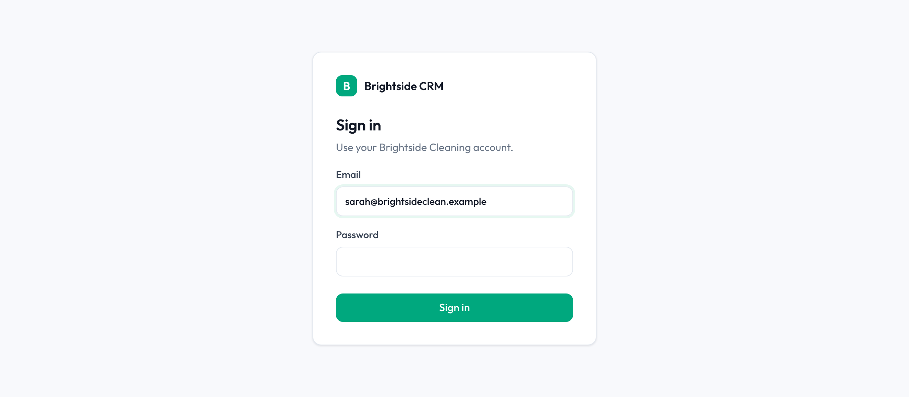
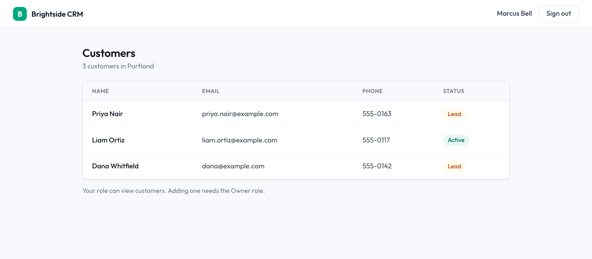
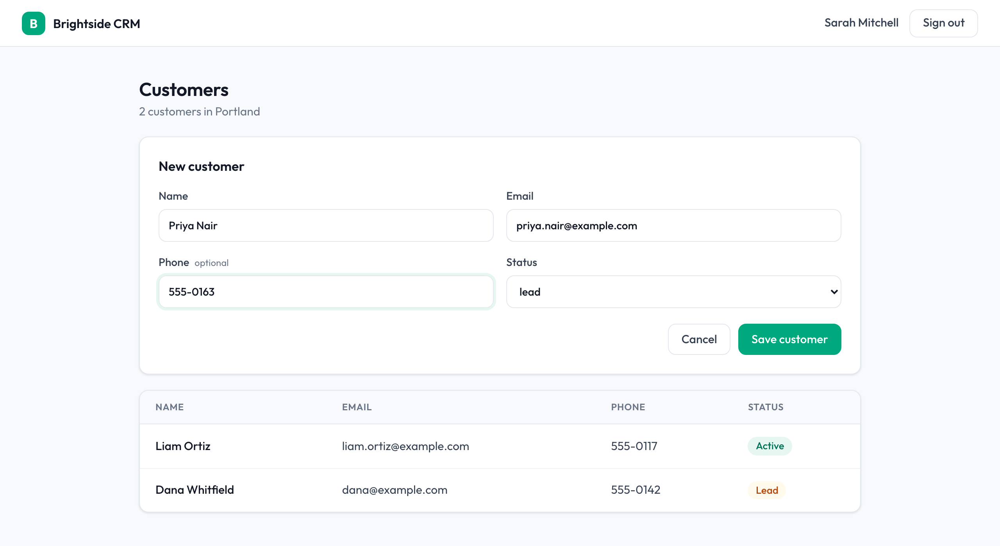
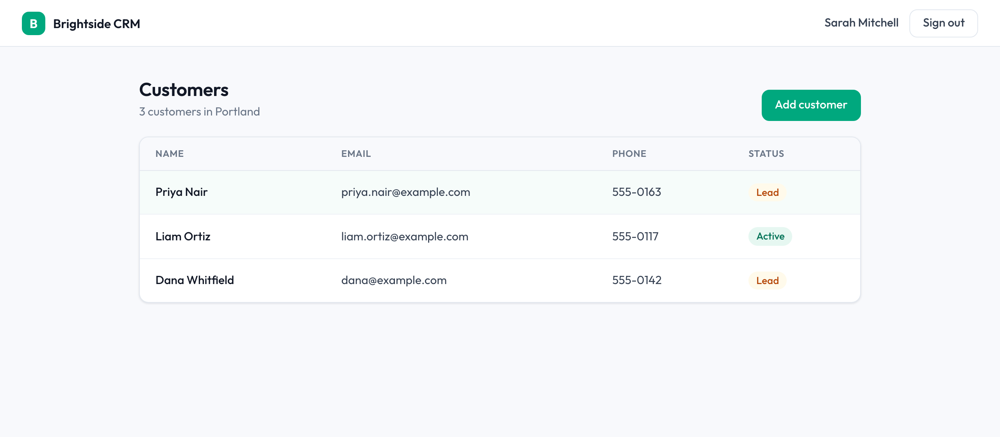
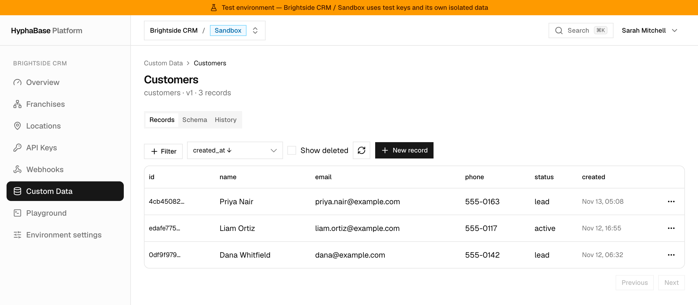

# Episode 5: the SDK and a real frontend

**Result:** the CRM has screens. Sarah signs in in a browser, sees the customers and adds one. Marcus signs in and sees the same list with no way to add to it. The requests to HyphaBase are now made with the SDK, and the secret key still never leaves the server.

**Tag:** `episode-05-sdk-frontend`

**Starts from:** the roles and the CRM server from [episode 4](episode-04-permissions.md).

## The problem

Until now the CRM was a set of terminal commands. A cleaning company's office is not going to run `npm run crm:customers`.

A frontend raises one question straight away: *where does the secret key go?* The browser cannot have it. Anything a browser downloads, anyone can read, and that key can read and write every customer.

So the app has two halves:

1. **Pages**, which run in the browser. They have no key and never see a token. They only talk to this app's own server.
2. **A small server**, which holds the secret key. For every request it works out who is asking and what their role allows, as in episode 4, and only then talks to HyphaBase.

Both halves live in one Next.js app, in the new [`web/`](../web) folder. The server half is a handful of Route Handlers. Everything from the earlier episodes still works and has not changed.

## Before you start

Each API key is a pair. You have been using the secret half (`sk_...`). The app now also uses the **publishable** half (`pk_...`) for the requests it makes on behalf of a person. Copy it from the **API Keys** page, where it has its own column, and add it to `.env`:

```bash
HYPHABASE_PUBLISHABLE_KEY=pk_test_...
```

The secret key needs no new scopes.

Then install the web app's dependencies (the earlier episodes had none):

```bash
npm --prefix web install
```

That also installs the HyphaBase SDK, the [`hyphabase`](https://www.npmjs.com/package/hyphabase) package on npm. In a project of your own it is `npm install hyphabase`.

## What changed

| File | What it does |
| --- | --- |
| [`web/lib/crm.ts`](../web/lib/crm.ts) | The CRM's server side: sign in, who am I, list, add and delete customers, sign out. Uses the SDK. Knows nothing about Next.js. |
| [`web/lib/customers.ts`](../web/lib/customers.ts) | What a customer is, and the checks on a new one. |
| [`web/lib/session-cookie.ts`](../web/lib/session-cookie.ts) | Keeps a person's session in a cookie the page's scripts cannot read. |
| [`web/lib/server.ts`](../web/lib/server.ts) | Builds the CRM from `.env` and connects it to a request. Marked server-only. |
| [`web/app/api/`](../web/app/api) | The Route Handlers. Each is three or four lines. |
| [`web/lib/api.ts`](../web/lib/api.ts) | What the pages call: this app's own `/api/...` routes. |
| [`web/components/`](../web/components) | The screens: sign-in, the customer table, the add-customer form. |

## Run it

```text
$ npm run web
▲ Next.js (Turbopack)
- Local: http://localhost:3010
```

Open it and sign in as Sarah:



First, sign in as Marcus instead. He has the Staff role from episode 4, which can read customers and nothing else:



There is no **Add customer** button for him. Sign out and sign in as Sarah, the owner. She has the button:



Save, and the new customer is at the top of the list without a page reload:



It is a real record in HyphaBase, not something the page is remembering. The console shows it:



The server's log tells the story of that minute:

```text
sign in 200
list customers 200
sarah@brightsideclean.example added customer 4cb45082-228d-4614-aa8b-7621b88af3c6
add customer 201
```

## From `fetch` to the SDK

In episode 2 the list of customers was a URL built by hand ([`src/customers.js`](../src/customers.js)), on top of a helper that set the headers, parsed the answer and turned failures into errors ([`src/hyphabase.js`](../src/hyphabase.js)):

```js
const RECORDS = "/api/modules/data/customers/records";

export async function listCustomers(api) {
  const { data } = await api.request(`${RECORDS}?sort=-created_at`);
  return data;
}
```

With the SDK ([`web/lib/crm.ts`](../web/lib/crm.ts)):

```ts
const server = createClient(apiUrl, secretKey, { storage: memoryStorage() });
const customers = server.data.collection<CustomerFields>("customers");

const page = await customers.list({ sort: "-created_at", limit: 100 });
```

The request that goes out is the same one. What you no longer write is the URL, the headers and the error handling, and `page.data` is typed: `page.data[0].status` is `"lead" | "active" | "inactive"`, not `any`.

The hand-written version was worth doing once. You know exactly what the SDK sends.

## Two clients, two keys

The server makes two kinds of request, and uses a separate SDK client for each.

**As the server itself**, with the secret key. This is the only client that touches customers:

```ts
const server = createClient(apiUrl, secretKey, { storage: memoryStorage() });
```

**As one person**, with the publishable key and that person's session:

```ts
const actingAs = (session: SessionStorageAdapter) =>
  createClient(apiUrl, publishableKey, { locationId, storage: session });
```

The second client signs people in, asks HyphaBase who a session belongs to, and asks what their roles allow. On its own, a publishable key can read no customer data. So if a session is missing, made up or revoked, this client has nothing to fall back on, and the request fails.

That is why it is not built with the secret key. A client that holds a secret key and has no valid session sends its requests as the key instead. That is right for a server acting as itself and wrong for "what may *this person* do": the answer would be everything the key can do.

## The session lives in a cookie

When Sarah signs in, the browser sends her email and password to this app's `/api/login`. The server signs her in with the SDK and keeps the session in a cookie ([`web/lib/session-cookie.ts`](../web/lib/session-cookie.ts)):

```ts
jar.set(SESSION_COOKIE, encodeSession(session), {
  httpOnly: true,
  sameSite: "strict",
  secure: process.env.NODE_ENV === "production",
  path: "/",
});
```

- `httpOnly`: no script on the page can read it. The reply to the page is `{ user: { id, name, email } }` and nothing else.
- `sameSite: "strict"`: another website cannot make Sarah's browser send it.

The SDK takes any object with `get`, `set` and `clear` as its session storage, so the cookie plugs straight in. When the SDK renews a session that is about to run out, it calls `set`, and the new one lands in the cookie with no code of ours involved.

## The check

The guard from episode 4, with the SDK doing the asking ([`web/lib/crm.ts`](../web/lib/crm.ts), shown here without its error handling):

```ts
async function identify(session: SessionStorageAdapter) {
  if (!session.get()) throw refuse(401, { error: "Sign in first." });

  const person = actingAs(session);
  const { user } = await person.profile.get();
  const { permissions } = await person.profile.permissions();
  return { user, permissions };
}

async function requirePermission(session: SessionStorageAdapter, permission: Permission) {
  const { user, permissions } = await identify(session);
  if (permissions.includes(permission)) return user;

  log(`${user.email} was refused: no ${permission}`);
  throw refuse(403, { error: "Your role does not allow this.", required_permission: permission });
}
```

The cookie also contains a name and an email. The server does not trust them: who the person is comes from HyphaBase, on every request.

Adding a customer is then three steps, in this order:

```ts
const user = await requirePermission(session, CAN.addCustomers);   // 401 or 403

const parsed = parseCustomer(input);                               // 422, one message per field
if (!parsed.ok) throw refuse(422, { error: "Check the highlighted fields.", errors: parsed.errors });

const customer = await customers.create(parsed.customer);          // as the server
```

`parseCustomer` passes on four fields (name, email, phone, status) and drops anything else the browser sent. A second customer with the same email is refused by HyphaBase, and the form shows it as `A customer with that email already exists.`

And a Route Handler is only the connection to HTTP ([`web/app/api/customers/route.ts`](../web/app/api/customers/route.ts)):

```ts
export async function POST(request: Request) {
  const body = await bodyOf(request);
  return respond(request, (crm, session) => crm.addCustomer(session, body));
}
```

## The page side

The pages call this app's routes with plain `fetch` ([`web/lib/api.ts`](../web/lib/api.ts)). There is no HyphaBase URL, key or token anywhere in them. After a successful save, the form hands the new customer to the table, which puts it first:

```ts
function added(customer: Customer) {
  setList((current) => (current.step === "ready" ? { step: "ready", customers: [customer, ...current.customers] } : current));
}
```

The **Add customer** button is shown when the person's permissions include `data.records.create`. That is a courtesy, as episode 4 promised. Marcus can still send the request by hand, and the server answers 403.

## What the tests prove

```bash
npm run web:test     # 48 tests, no network
npm run smoke:web    # the built app against your real environment
```

The smoke test builds the app, starts it and talks to it as a browser would:

- no cookie: 401. A cookie somebody made up, naming a real user: 401
- a wrong password: 401
- a staff user: reads the customers; adding one is refused (403)
- an owner: bad input is refused with a message per field (422); a good customer is added (201); the same email again is refused (409)
- a request sent from another website: refused (403)
- after signing out, the old cookie no longer works (401): the session ended at HyphaBase, not only in the browser
- the secret key is in no file the browser can download

It creates two test users and one customer, and removes them when it is done.

## Things worth noticing

- **The secret key cannot reach the browser by accident.** `web/lib/server.ts` imports `server-only`, so the build fails if a page ever imports it. Next.js also only hands the browser variables named `NEXT_PUBLIC_...`, and this app has none.
- **The browser holds no token.** Not in the page, not in local storage. A script injected into the page has nothing to steal.
- **The rules did not move.** Roles, permissions and the two refusals (401 and 403) are exactly episode 4's. The screens were added on top.
- **The server logic is not tied to Next.js.** `web/lib/crm.ts` takes a session store and plain input and returns a status and a body. The tests run it with no web server at all, and it would sit behind any other Node server unchanged.
- **The terminal commands still work.** `npm run serve` and the `crm:*` commands from episodes 3 and 4 are untouched. From here on the web app is the CRM.

## Known limits at this point

- Three HyphaBase requests per customer request (who, what, then the data). Fine for a staff tool; a busier app would cache the first two for a short time.
- If the same person has two tabs open at the moment their session is renewed, one tab can be asked to sign in again.
- The list shows the newest 100 customers. There is no search or paging yet.
- A person can add a customer but not edit or delete one from the screen. The delete route exists and is tested; the buttons come next.
- `next start` marks the cookie `Secure`. Chrome and Firefox accept that on `http://localhost`; Safari may not, so use `npm run web` there.
- The SDK is at 0.0.1 and not published yet.

Next: episode 6, editing and deleting customers.
