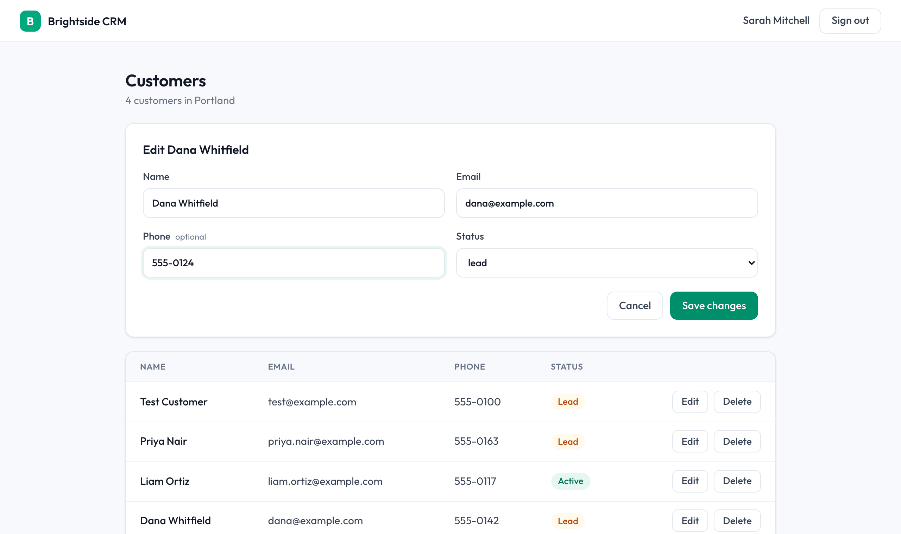
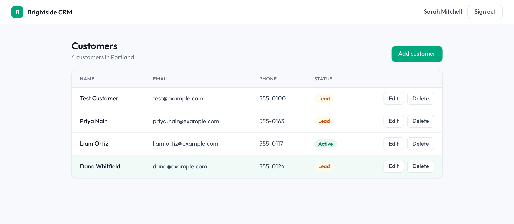
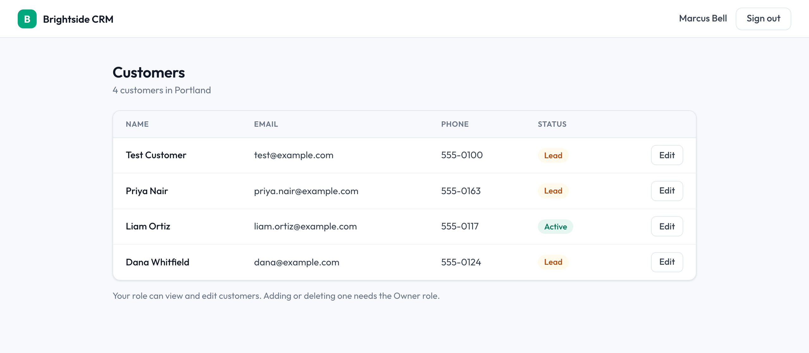
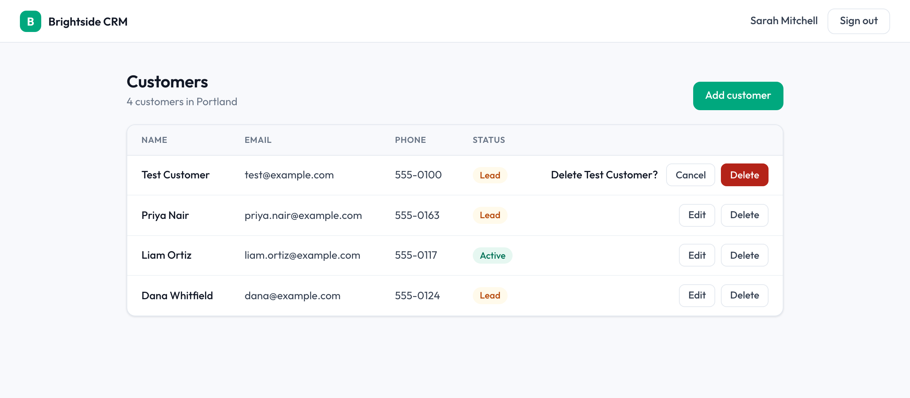
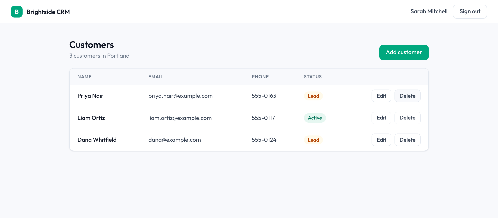

# Episode 6: editing and deleting customers

**Result:** a customer can be corrected and removed from the screen. Sarah, the owner, can do both. Marcus, on staff, can fix a phone number but cannot delete anyone: his screen has no Delete button, and when he sends the request by hand anyway the server answers 403 and the customer is still there.

**Tag:** `episode-06-update-delete`

**Starts from:** the web app from [episode 5](episode-05-sdk-frontend.md).

## The problem

Dana Whitfield's phone number was typed wrong back in episode 2, and nobody could fix it. The CRM could show a customer and add one. That was all.

Edit and delete are the first two actions that can damage data that is already there, so before any button there is a question to answer: *who should be able to do which?*

For Brightside the answer is short. Whoever answers the phone needs to fix a number, so **Staff can edit**. Removing a customer is rarer and harder to take back, so **only the Owner can delete**. That is a change to the roles from episode 4, where Staff could only read.

The rest of the episode is the same pattern as adding a customer: the server decides, and the screen follows.

## Before you start

The secret key needs two more scopes. Edit the key in the console and add:

- `data.records.update`, so the server can change a customer
- `roles.update`, so `roles:setup` can change the roles you already have

Then run the roles setup again. It finds the two roles from episode 4 and gives each the permission it is missing:

```text
$ npm run roles:setup
Updated role Owner
  data.records.read
  data.records.create
  data.records.delete
  data.records.update
Updated role Staff
  data.records.read
  data.records.update
```

Sarah and Marcus keep the roles they have. Nobody is given a role again, and they do not need to sign in again: the server asks HyphaBase what a person may do on every request.

## What changed

| File | What it does |
| --- | --- |
| [`src/roles.js`](../src/roles.js) | Owner gains edit; Staff goes from read to read and edit. `ensureRole` now adds missing permissions to a role that is already there. |
| [`web/lib/customers.ts`](../web/lib/customers.ts) | `parseCustomerChanges`: the checks for an edit, which may carry any of the four fields. |
| [`web/lib/crm.ts`](../web/lib/crm.ts) | `updateCustomer`, beside the `deleteCustomer` that episode 5 already had. |
| [`web/app/api/customers/[id]/route.ts`](../web/app/api/customers/%5Bid%5D/route.ts) | `PATCH`, beside `DELETE`. |
| [`web/lib/api.ts`](../web/lib/api.ts) | `updateCustomer` and `deleteCustomer` for the pages. |
| [`web/components/customer-form.tsx`](../web/components/customer-form.tsx) | The add-customer form, now one form for adding and editing. |
| [`web/components/customers.tsx`](../web/components/customers.tsx) | An Edit and a Delete button on each row, for the people whose role allows them. |

## Run it

```text
$ npm run web
▲ Next.js (Turbopack)
- Local: http://localhost:3010
```

Sign in as Sarah. Every row now has **Edit** and **Delete**. Edit Dana and correct the number:



Save, and the row has the new number without a page reload:



Sign out and sign in as Marcus. He has **Edit** on every row, and no **Delete**:



A missing button stops nobody who knows what the request looks like. While signed in as Marcus, open the browser's console and send it yourself, with the id of any customer:

```js
await fetch("/api/customers/0df9f979-555f-4adf-8e88-066371e5cfce", { method: "DELETE" }).then((r) => r.json())
```

```json
{
  "error": "Your role does not allow this.",
  "required_permission": "data.records.delete"
}
```

The status is 403 and Dana is still in the list. The button was never what protected her.

Back as Sarah. Somebody has added a test customer again. **Delete** asks first:



Confirm, and the row is gone:



The server's log has all of it, including the request Marcus should not have sent:

```text
sarah@brightsideclean.example updated customer 0df9f979-555f-4adf-8e88-066371e5cfce
update customer 200
marcus@brightsideclean.example was refused: no data.records.delete
delete customer 403
sarah@brightsideclean.example deleted customer c5714271-f2ff-4552-a740-53c67e8a25fe
delete customer 204
```

## The check, on the server

Changing a customer is the same steps as adding one, in the same order ([`web/lib/crm.ts`](../web/lib/crm.ts), shown here without its error handling):

```ts
const user = await requirePermission(session, CAN.updateCustomers);   // 401 or 403
if (!CUSTOMER_ID.test(id)) throw noSuchCustomer();                    // 404

const parsed = parseCustomerChanges(input);                           // 422, one message per field
if (!parsed.ok) throw refuse(422, { error: "Check the highlighted fields.", errors: parsed.errors });

const customer = await customers.update(id, parsed.changes);          // as the server
```

The role is checked first. Someone who may not edit learns nothing from the request: not whether the id exists, not whether their input was valid.

An edit is a `PATCH` and carries only what changed. `parseCustomerChanges` checks the fields that were sent with the same rules and the same messages as a new customer, leaves the others out, and drops anything that is not one of the four. A field that is not sent keeps its value:

```ts
if (raw.name !== undefined) changes.name = check.name(raw.name, errors);
if (raw.email !== undefined) changes.email = check.email(raw.email, errors);
if (raw.phone !== undefined) changes.phone = check.phone(raw.phone, errors) || null;
if (raw.status !== undefined) changes.status = check.status(raw.status, errors);
```

An emptied phone number is sent to HyphaBase as `null`, which removes it. Changing an email to one another customer already has is refused by HyphaBase, and the form shows `A customer with that email already exists.`, as it does when adding.

Deleting was already written and tested in episode 5. It is the same two lines of checks, then `customers.delete(id)`.

With the SDK each of the two is one call:

```ts
await customers.update(id, { phone: "555-0124" });
await customers.delete(id);
```

## The page side

The form sends only the fields the person changed ([`web/components/customer-form.tsx`](../web/components/customer-form.tsx)). If Sarah fixes a phone number while Marcus changes the same customer's status, neither undoes the other. Saving with nothing changed closes the form and sends no request.

Each button is shown when the person's permissions include the matching one ([`web/components/customers.tsx`](../web/components/customers.tsx)):

```ts
// Hiding a button is a courtesy. The server checks the permission again on every request.
const mayAdd = permissions.includes(CAN.addCustomers);
const mayEdit = permissions.includes(CAN.updateCustomers);
const mayDelete = permissions.includes(CAN.deleteCustomers);
```

A row leaves the table only after the server has answered 204. If the delete is refused or fails, the row stays and the reason is shown above the table.

## What the tests prove

```bash
npm test             # 52 tests, no network
npm run web:test     # 73 tests, no network
npm run smoke        # the roles, against your real environment
npm run smoke:web    # the built app against your real environment
```

New in the web app's smoke test:

- a staff user edits a customer (200); an edit with a bad email is refused with a message for that field (422); an edit with no fields is refused (422)
- a staff user's delete is refused (403, naming `data.records.delete`), and the customer is still there
- an owner edits a status and clears a phone number (200), and the staff user sees the change
- changing an email to another customer's is refused (409)
- an owner deletes the customer (204); it is gone for everyone; deleting or editing it again is 404
- with no cookie, editing and deleting are both 401

It creates two test users and two customers, and removes them when it is done.

## Things worth noticing

- **Two roles, one difference.** The whole of "staff can edit but not delete" is one permission that the Staff role does not carry. The server has no `if (role === "owner")` anywhere; it asks whether the person has the permission the action needs.
- **Changing a role needed no deploy and no new sign-in.** `roles:setup` changed the roles in HyphaBase, and the next request from Marcus was allowed to edit.
- **The delete is a soft delete.** HyphaBase marks the record as deleted and stops returning it; it does not erase it straight away. The SDK has a `restore` for it. The CRM does not offer one yet, and the customer's email can be used again for a new customer in the meantime.
- **The server never trusts the id either.** An id that is not shaped like a record id is answered with 404 without asking HyphaBase.
- **The terminal commands still work.** `npm run crm:delete` from episode 4 behaves as before: Marcus is refused, Sarah is not.

## Known limits at this point

- Two people editing the *same field* at the same moment: the last save wins, and nobody is told.
- There is no undo for a delete on the screen, and no list of deleted customers.
- The log line on the server is the only record of who changed what. It says who and which customer, not what the old value was.
- The list still shows the newest 100 customers, with no search or paging.
- Three HyphaBase requests per customer request, as in episode 5.

Next: episode 7, searching, filtering and paging through the customer list.
