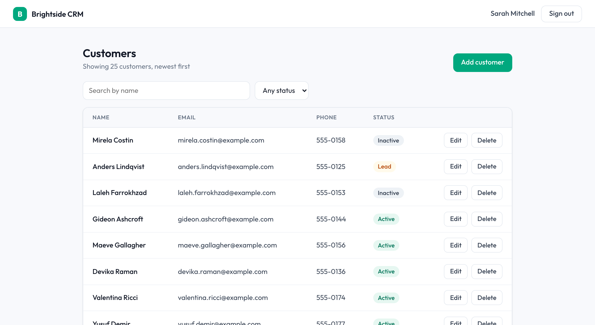
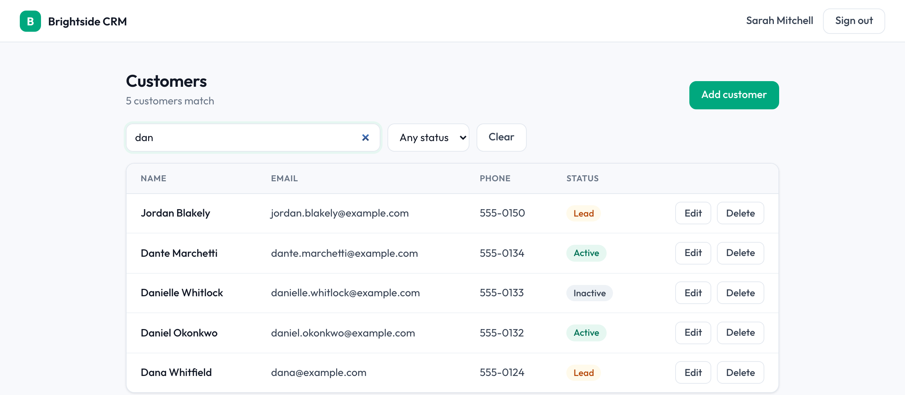
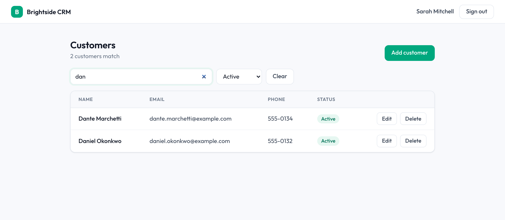
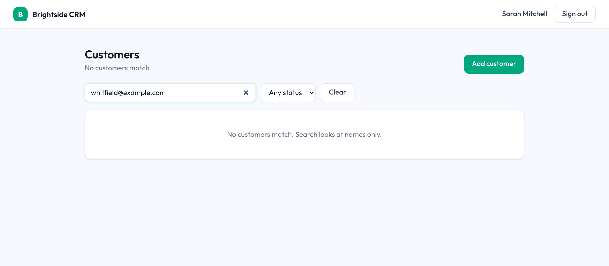
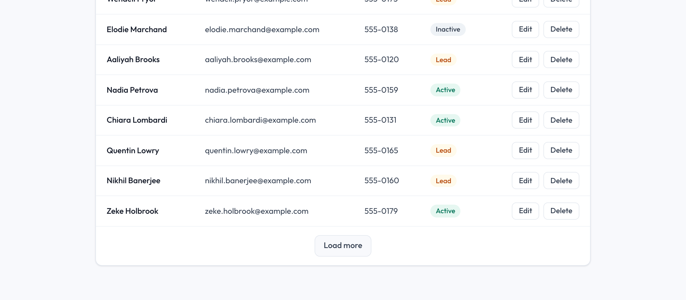
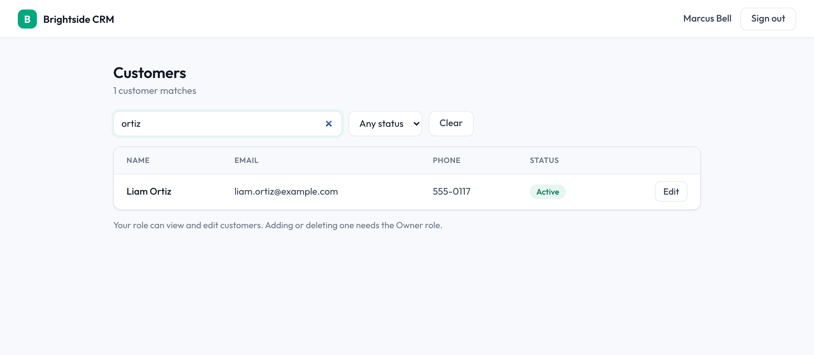

# Episode 7: searching, filtering and paging through the customer list

**Result:** the customer list can be searched by name, narrowed by status, and read 25 customers at a time. The searching is done by HyphaBase, not in the browser. The address bar holds the search, so a reload or a bookmark shows the same list.

**Tag:** `episode-07-search-paging`

**Starts from:** the web app from [episode 6](episode-06-update-delete.md).

## The problem

With three customers, finding Dana meant looking at the screen. Brightside has a few hundred regulars, and the list from episode 6 asked for "the newest 100" and showed whatever came back. Customer 101 was not on the screen at all, and nothing said so.

The quick fix is to download every customer and filter in the browser. It works on the day you write it. Then the list grows, every visit downloads all of it, and every person who can open the page holds a full copy of the customer table in their browser's memory.

So the list is asked a question instead: *customers whose name contains "dan", who are active, 25 at a time.* HyphaBase answers it from the database, and the browser only ever holds what is on the screen.

Nothing about the roles changes. Reading the list needed `data.records.read` before and needs it now, for Sarah and for Marcus.

## Before you start

The key needs no new scope. What the list needs is customers, enough of them that there is a second page. One command adds sixty:

```text
$ npm run customer:seed
Added 60 sample customers.
```

Every one of them is made up: the emails end in `example.com` and the phone numbers are in the 555-01xx range kept for fiction. It finds customers by email before adding, so running it again adds nothing:

```text
$ npm run customer:seed
Added 0 sample customers. 60 were already there.
```

All sixty go to HyphaBase in one request, as a batch ([`src/seed.js`](../src/seed.js)). A batch is all or none: if one record is refused, none are created.

## What changed

| File | What it does |
| --- | --- |
| [`src/seed.js`](../src/seed.js), [`src/seed-customers.js`](../src/seed-customers.js) | The sixty sample customers, and `npm run customer:seed`. |
| [`web/lib/customers.ts`](../web/lib/customers.ts) | `parseListQuery`: reads a search, a status and a cursor out of whatever the browser sent. `toSearch` and `readListQuery` for the address bar. |
| [`web/lib/crm.ts`](../web/lib/crm.ts) | `listCustomers` now takes that question, and returns one page and the cursor for the next. |
| [`web/app/api/customers/route.ts`](../web/app/api/customers/route.ts) | `GET` reads `q`, `status` and `cursor` from the address, and nothing else. |
| [`web/lib/api.ts`](../web/lib/api.ts) | `customers(filter, cursor)` for the pages. |
| [`web/components/customers.tsx`](../web/components/customers.tsx) | The search box, the status filter, **Load more**, and the line that says how much of the list you are looking at. |

## Run it

```text
$ npm run web
▲ Next.js (Turbopack)
- Local: http://localhost:3010
```

Sign in as Sarah. The list shows 25 customers and says so:



Type `dan` in the search box. The list narrows as you type, to everyone with "dan" anywhere in their name, in capitals or not:



Set the status to **Active**. Both apply:



The address bar now ends in `?q=dan&status=active`. Reload the page, or send the address to someone else who can sign in, and the same two customers are there.

The search looks at names. Type part of an email and nothing matches, and the screen says why:



**Clear** brings the whole list back. At the bottom, **Load more** adds the next 25 under the ones already there:



Press it until the button goes away. That is the end of the list, and only then does the line under the heading give a total.

Marcus can search too. Finding a customer is reading, and his role can read:



Signed out, the same request finds nothing out. Sign out, open the browser's console, and ask:

```js
await fetch("/api/customers?q=dan").then((r) => r.json())
```

```json
{ "error": "Sign in first." }
```

The status is 401. The search was never run.

## The question, on the server

The page asks this app's server, and the server asks HyphaBase ([`web/lib/crm.ts`](../web/lib/crm.ts), shown here without its error handling):

```ts
await requirePermission(session, CAN.readCustomers);                  // 401 or 403

const parsed = parseListQuery(input);                                 // q, status, cursor. Nothing else.
if (!parsed.ok) throw noSuchPage();                                   // 422
const { q, status, cursor } = parsed.query;

const filter = { ...(q ? { name: { contains: q } } : {}), ...(status ? { status } : {}) };
const page = await customers.list({ filter, sort: "-created_at", limit: PAGE_SIZE, cursor });

return { data: page.data.map(toCustomer), next_cursor: page.meta.next_cursor };
```

The role is checked first, as always.

Look at what the browser controls in that: two values and a cursor. The field that is searched (`name`), how it is compared (`contains`), the order and the page size are all written on the server. A request for `?limit=5000` gets 25 customers. A request for `?filter[email][contains]=@` gets the same list as no filter at all, because the server never reads it.

`parseListQuery` ([`web/lib/customers.ts`](../web/lib/customers.ts)) trims the search and stops it at 100 characters. A status that is not one of the three is left out. What is typed is always sent as a value: searching for `%` finds customers with a percent sign in their name, which is to say nobody.

## Pages without page numbers

HyphaBase does not page with "page 3". Each answer carries a `next_cursor`, and sending it back returns the customers that come after:

```ts
const first = await customers.list({ sort: "-created_at", limit: 25 });
const second = await customers.list({ sort: "-created_at", limit: 25, cursor: first.meta.next_cursor });
```

The cursor is a bookmark: it records the last customer you were given, and the next page starts after that customer. With page numbers, "page 2" means "skip 25 rows", and if Marcus adds a customer while Sarah is reading page 1, every row moves down one and her page 2 starts with a customer she has already seen. A cursor does not count rows, so nothing is shown twice and nothing is skipped.

On the last page `next_cursor` is `null`, and the screen takes the button away.

What you do not get is a total. HyphaBase returns a page and whether there is another, so the screen says "Showing 25 customers" until the last page is loaded, and never "page 1 of 40".

A cursor is only good if HyphaBase handed it out. The server refuses anything else:

```json
{ "error": "That page is not available any more. Start the list again." }
```

That is a 422. Answering with page one instead would put customers on the screen twice.

## The page side

The search box does not send a request for every key. It waits a quarter of a second after the last one ([`web/components/customers.tsx`](../web/components/customers.tsx)). Typing `dan` at a normal speed is one request, not three.

Answers can still come back in the wrong order: a slow answer for `da` arriving after a fast one for `dan`. Each request is numbered, and an answer is used only if it belongs to the newest one:

```ts
const request = ++asked.current;
// ...
const page = await api.customers(filter);
if (request !== asked.current) return;   // an older question. Its answer is thrown away.
```

The search is kept in the address with `history.replaceState`, so the Back button is not filled with one entry per letter. The cursor is not kept there. An address with a cursor in it would open in the middle of the list, with no way to see what came before.

**Load more** adds to the list on screen. A customer who is already there, because somebody added or edited them in the meantime, is not shown a second time.

## What the tests prove

```bash
npm test             # 58 tests, no network
npm run web:test     # 106 tests, no network
npm run smoke        # the roles, against your real environment
npm run smoke:web    # the built app against your real environment
```

New in the web app's smoke test, which adds 27 customers of its own so the counts are known:

- seeding twice adds 27, then 0
- the first page is 25 with a cursor; the second is the other 2 with no cursor; no customer is on both
- a search in capitals finds names in lower case
- search and status together find the 9 that are active; a status that does not exist is ignored
- `%` and `_` in a search are text, and match nothing
- a `limit` or a `filter` in the address changes nothing
- a made-up cursor is 422, and so is a real one that HyphaBase does not recognise
- with no cookie, a search is 401

It removes its 27 customers when it is done.

## Things worth noticing

- **The browser never holds the customer table.** It holds the rows on screen. Somebody who opens the network tab sees 25 customers, or the ones they searched for, and their role had to allow reading them.
- **"Newest first" is by the time a customer was created.** The sixty from the seed were created in the same moment, so among themselves they are in no order you would recognise. It is still the same order on every request, which is what paging needs: HyphaBase breaks ties by id.
- **Searching is not a permission.** There is one check, `data.records.read`. If Brightside ever wants some people to see only some customers, that is a different feature from a search box.
- **Add, edit and delete work inside a search.** A new customer goes to the top of whatever list is showing, whether or not they match the search.

## Known limits at this point

- Search looks at the name only. HyphaBase's record filters combine with *and*, so "name **or** email contains" is not one request. Two requests merged in the app would break the paging, so the CRM does not pretend.
- No total, and so no "page 1 of 40" and no "312 customers" until the last page has loaded.
- Paging goes forward only. There is no cursor for the page before; the screen keeps what it has loaded instead.
- The order is fixed at newest first. The column headings do not sort.
- A customer edited so that they no longer match the search stays on screen until the next search.
- `npm run customer:list`, the terminal command from episode 2, still prints one page: the newest 25.
- Three HyphaBase requests per customer request, as in episode 5.
