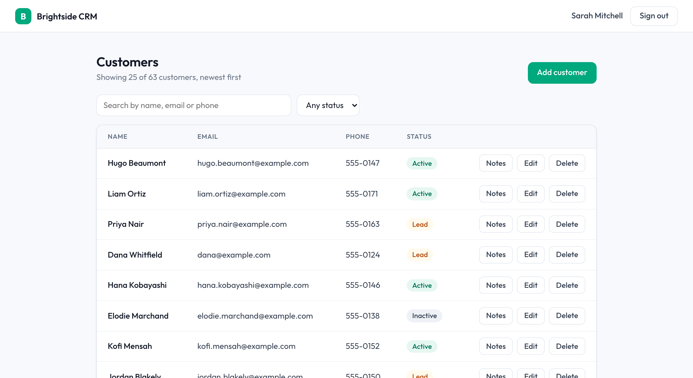
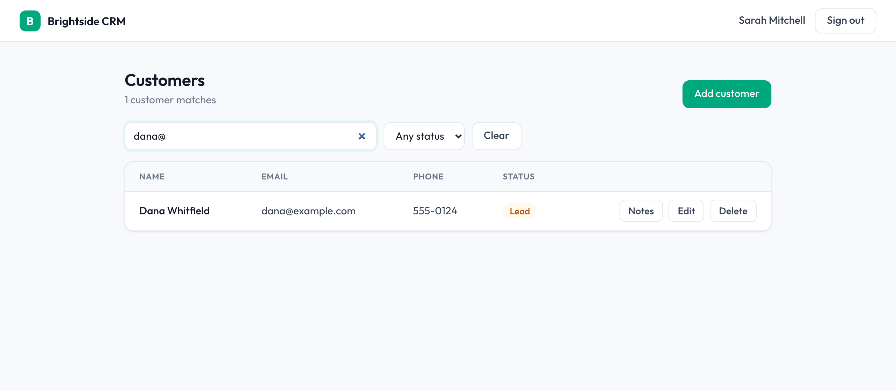
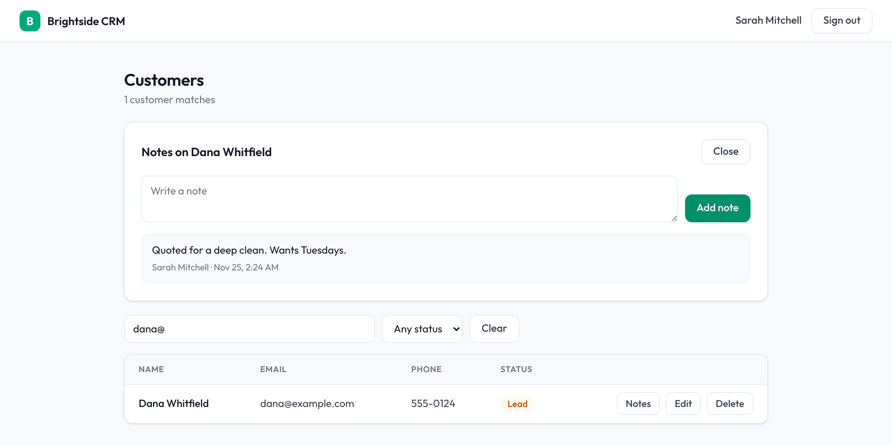
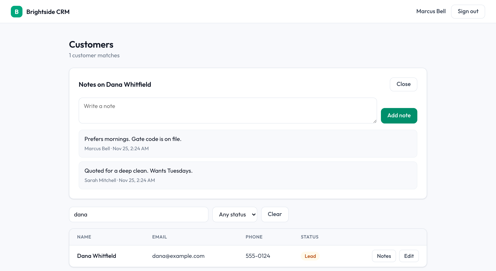

# Episode 8: the Clients module, and notes on a customer

**Result:** every customer can carry notes, and each note says who wrote it and when. To get there the customers move out of the collection we defined in episode 2 and into HyphaBase's Clients module, which already has notes. On screen the CRM looks the same, with one new button on every row.

**Tag:** `episode-08-clients-notes`

**Starts from:** the web app from [episode 7](episode-07-search-paging.md).

## The problem

Marcus finishes a call with Dana. She wants mornings, and there is a gate code. Where does that go?

The first idea is a `notes` field on the customer. One field holds one piece of text: the second note overwrites the first, and nothing says who wrote it. The second idea is a notes collection of our own, with a customer id, an author and a time on every record. That works, and it is the start of rebuilding something HyphaBase already has.

HyphaBase comes in modules. Each one is a part of a backend that most business software ends up needing, already built: the data, the API, the permissions. The data module is the one this series has used so far, for a collection we described ourselves. **Clients** is another: people your business serves, with a name, an email, a phone number, a status, and notes. You turn on the modules your app needs and leave the rest off. An app that never takes a payment never sees the payments API.

So this episode moves the customers into the Clients module and uses its notes. The CRM keeps calling them customers. "Client" is the module's word, and it stays on the server.

## Before you start

The key needs new scopes. In the console, edit the key and add:

| Scope | For |
| --- | --- |
| `clients.view`, `clients.create`, `clients.update`, `clients.delete` | reading and writing clients |
| `clients.view_name`, `clients.view_email`, `clients.view_phone` | seeing those three fields in full. Without them the API masks them. |
| `client_statuses.view`, `client_statuses.manage` | the statuses a client can have |

The module has no statuses until you name them. Create the three the collection had:

```text
$ npm run clients:setup
Created status Lead
Created status Active
Created status Inactive
```

Then move the customers:

```text
$ npm run customers:move
Moved 63 customers into the Clients module.
```

It copies every customer and gives each the status it had. It finds clients by email, so running it again moves nobody twice:

```text
$ npm run customers:move
Moved 0 customers into the Clients module. 63 were already there.
```

The Clients module asks for more than our collection did: a first name, a last name and a phone number. A customer without a last name or a phone number is not moved, and the command prints which and why. Nothing is guessed. The collection itself is left as it was; delete it in the console when you no longer need it.

Last, the roles. The permissions have new names, because they belong to a different module:

```text
$ npm run roles:setup
```

| Role | Before | Now |
| --- | --- | --- |
| Owner | `data.records.read`, `.create`, `.update`, `.delete` | adds `clients.view`, `clients.create`, `clients.update`, `clients.delete` |
| Staff | `data.records.read`, `.update` | adds `clients.view`, `clients.update` |

The old permissions stay on the roles, so the server from episode 4 still works.

## What changed

| File | What it does |
| --- | --- |
| [`src/clients.js`](../src/clients.js) | `ensureClientStatuses`, `toClient` and `moveCustomers`. |
| [`src/setup-clients.js`](../src/setup-clients.js), [`src/move-customers.js`](../src/move-customers.js) | `npm run clients:setup` and `npm run customers:move`. |
| [`src/roles.js`](../src/roles.js) | The Owner and Staff roles gain the client permissions. |
| [`web/lib/permissions.ts`](../web/lib/permissions.ts) | The four things the CRM checks, under their new names. |
| [`web/lib/customers.ts`](../web/lib/customers.ts) | A customer has a first and a last name and a phone number. `parseNote`. Pages are numbered. |
| [`web/lib/crm.ts`](../web/lib/crm.ts) | Every customer function now talks to the Clients module. New: `listNotes` and `addNote`. |
| [`web/app/api/customers/[id]/notes/route.ts`](../web/app/api/customers/%5Bid%5D/notes/route.ts) | `GET` and `POST` for one customer's notes. |
| [`web/components/notes.tsx`](../web/components/notes.tsx) | The notes panel. |
| [`web/components/customers.tsx`](../web/components/customers.tsx), [`web/components/customer-form.tsx`](../web/components/customer-form.tsx) | A **Notes** button on every row; the form asks for a first and a last name. |

## Run it

```text
$ npm run web
▲ Next.js (Turbopack)
- Local: http://localhost:3010
```

Sign in as Sarah. The same customers, the same statuses, and one new button:



Two things came with the module without being asked for. The line under the heading gives a total, which episode 7 could not. And the search looks at the email and the phone number as well as the name:



Press **Notes** on Dana, write a note and add it:



Sarah typed the text. She did not type her name or the time.

Sign out and sign in as Marcus. He can read Sarah's note and add his own:



Adding a note needs the same permission as editing a customer, and Staff has it. Deleting a customer is still the Owner's.

## Who wrote it

Until now every request for data went to HyphaBase as the server, with the secret key, after the CRM had checked the person's role itself. A note is different. If the server wrote it, HyphaBase would record no author, and the CRM would have to store one itself: a name in a field, which is a name that can be wrong.

So a note is the one thing the CRM sends as the person ([`web/lib/crm.ts`](../web/lib/crm.ts), shown here without its error handling):

```ts
const user = await requirePermission(session, CAN.updateCustomers);   // 401 or 403

const parsed = parseNote(input);                                      // the text. Nothing else.
if (!parsed.ok) throw refuse(422, { error: parsed.error });

const note = await actingAs(session).clients.notes(id).create({
  category: "General",
  content: parsed.content,
  visibility: "internal",
});
```

`actingAs(session)` is the SDK client that carries the person's own token, the one that has only been used for "who am I" since episode 5. HyphaBase checks their role a second time and records them as the author. The browser sends one thing, the text. A request that adds `"author": "Somebody Else"` gets a note signed by whoever is signed in, because the server never reads that field.

`"internal"` keeps the note among the people who work at Brightside. The category is the module's way to group notes; the CRM uses one.

## The same list, asked differently

`listCustomers` asks the Clients module what it used to ask the collection:

```ts
const query = new URLSearchParams();
if (q) query.set("search", q);
if (status) query.set("client_status_id", await statusId(status));
query.set("sort_by", "created_at");
query.set("sort_direction", "desc");
query.set("per_page", String(PAGE_SIZE));
query.set("page", String(page));
```

The browser still controls a search, a status and which page, and nothing else.

Three differences are worth knowing:

- **A status is a record, not a word.** The module keeps statuses in their own list, and a client points at one by id. The CRM looks the three ids up once and remembers them. If they were never created, it says what to run.
- **A status is set with a second request.** Adding a customer creates the client, then gives it a status. The status is kept per location, so the same client can be a lead in Portland and active in Salem.
- **Pages have numbers.** The module answers with `current_page`, `last_page` and `total`. That is where "25 of 63" comes from. It also brings back the weakness episode 7 described: if someone adds a customer while you are reading, the next page starts one row early. **Load more** leaves out anyone already on screen, so nobody is shown twice.

## Delete is not for ever

Deleting a client archives it. HyphaBase keeps it for 30 days and it can be restored there. To the CRM an archived customer is gone: the list does not show it, and editing it, deleting it again or reading its notes answers 404.

## What the tests prove

```bash
npm test             # 68 tests, no network
npm run web:test     # 137 tests, no network
npm run smoke        # the roles, against your real environment
npm run smoke:web    # the built app against your real environment
```

New in the web app's smoke test:

- staff adds a note; it comes back signed with their name and timed within the last few minutes
- an author sent by the browser is ignored
- notes are listed newest first, for the owner and for staff
- an empty note is 422; notes on a customer that does not exist are 404; with no cookie, reading or writing one is 401
- the first page is 25 with a total of 27; the second is the other 2; no customer is on both
- part of an email finds a customer
- a `per_page`, a `sort_by` or a `client_status_id` in the address changes nothing
- a page that is not a number is 422; a page past the end is empty
- deleting a customer twice is 404 the second time

It archives its customers when it is done.

## Things worth noticing

- **The pages did not change, the server did.** The browser still asks `/api/customers`. Because the CRM's own server sits between the page and HyphaBase, where the customers are stored could change without the screens knowing.
- **Permissions belong to modules.** `data.records.read` says nothing about clients. A person whose role still carries only the old permissions sees nothing, which is the safe way round.
- **Two checks on a note.** The CRM checks the role before it looks at the text, and HyphaBase checks it again when the note arrives as that person.
- **Three scopes just to see a name.** A key without `clients.view_name`, `clients.view_email` and `clients.view_phone` gets masked values. A key for a reporting job can count clients without being able to read who they are.

## Known limits at this point

- Search looks for what you typed inside one field at a time: a first name, a last name, an email or a phone number. `dana` works and `whitfield` works. `dana whitfield` finds nobody, because no single field holds both words.
- A note cannot be edited or deleted from the screen.
- Two notes added in the same second have no order between them.
- A customer needs a phone number now. The module requires one.
- An archived customer's email stays taken. Adding a new customer with that email is refused until the old one is restored or removed for good at HyphaBase.
- The sort order is still fixed at newest first.
- `npm run customer:add`, `customer:list` and `customer:seed` still talk to the collection. Run `npm run customers:move` after them.
- Three HyphaBase requests per customer request, as in episode 5. Adding a customer or changing a status is one more.
